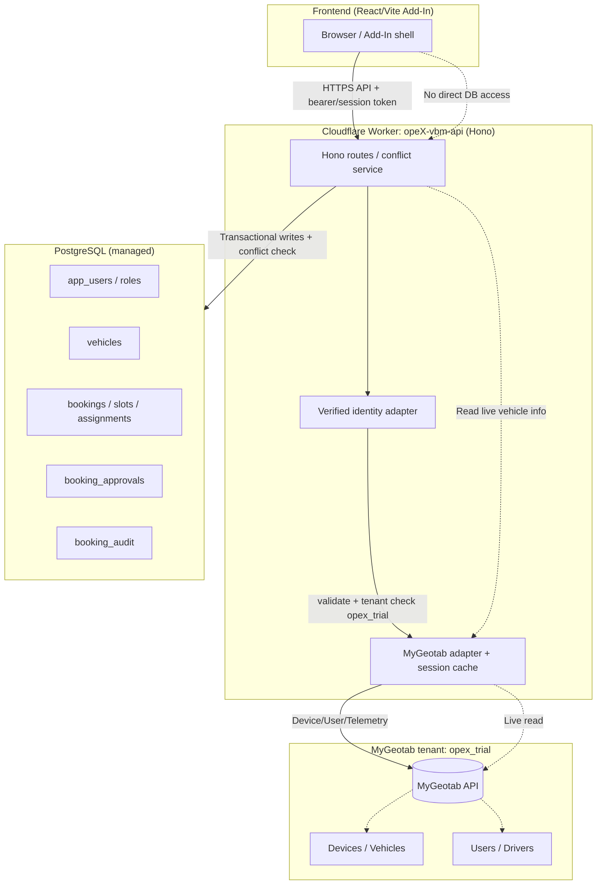
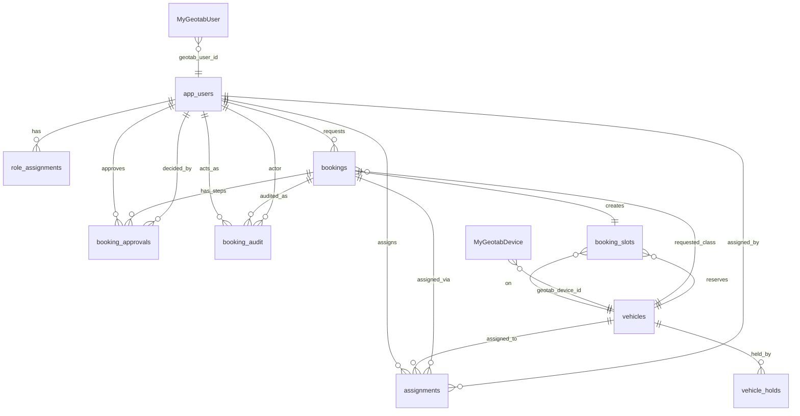

# MyGeotab + PostgreSQL Data Architecture
OPEX Vehicle Booking Management (VBM)

**Status:** design document only. No infrastructure created, no migrations modified, no deployment performed.
**Target tenant:** `opex_trial`

---

## 1. Source of truth matrix

| Domain | Source of truth | PostgreSQL stores | MyGeotab provides (live) | Notes |
|---|---|---|---|---|
| Fleet / vehicles | MyGeotab (Device) | `vehicles` row keyed by `geotab_device_id` | Device id, name, serial, registration, status, telemetry | MyGeotab is authoritative for vehicle existence and identity; PostgreSQL mirrors a lightweight reference + booking-specific attributes |
| Users / drivers | MyGeotab (User) | `app_users` row keyed by `geotab_user_id` | User id, name, email, groups/drivers | MyGeotab is authoritative for identity; PostgreSQL stores app roles/permissions mapping |
| Bookings / schedule | PostgreSQL | `bookings`, `booking_slots`, `assignments`, `booking_approvals` | None (read-only enrichment) | OPEX transactions are authoritative here; never replicated to MyGeotab |
| Approvals / rejections | PostgreSQL | `booking_approvals`, `booking_audit` | None | Complete lifecycle and history owned by PostgreSQL |
| Audit trail | PostgreSQL | `booking_audit` | None | Immutable append-only record |
| Vehicle status / telemetry | MyGeotab | Optional short-lived cache | Current status, location, odometer | Enrichment only; never overrides booking state |

Rule: never duplicate the entire MyGeotab fleet into PostgreSQL. Store only the stable reference (`geotab_device_id` / `geotab_user_id`) plus application-specific attributes.

---

## 2. Data flow diagram



Key flows:
1. **Identity:** Frontend presents a session/token to the Worker. The verified identity adapter resolves a principal, validates the user belongs to `opex_trial`, and maps MyGeotab user id → `app_users.id`.
2. **Vehicle lookup:** Worker calls MyGeotab API for current device info (cached per strategy below), resolves `geotab_device_id` → `vehicles` row.
3. **Booking write:** All mutation happens transactionally in PostgreSQL with conflict prevention. MyGeotab is never written to.

---

## 3. Entity relationship diagram



Legend: tables in PostgreSQL; `MyGeotabDevice` / `MyGeotabUser` are external entities (not PostgreSQL tables) referenced by stable id.

---

## 4. Database schema proposal

Existing migrations (`0001_initial.sql`, `0002_reservation_slots.sql`) are **preserved unchanged**. They already implement most of the required tables:
- `app_users`, `role_assignments`
- `vehicles` (with `geotab_device_id` external reference)
- `bookings`, `booking_approvals`, `assignments`, `booking_audit`
- `reservation_slots` (GiST exclusion constraint)
- `vehicle_holds`, `handovers`, `notification_outbox`, `idempotency_records`

No existing migration is altered. Any additive schema changes would land in a **new** migration file (e.g. `0003_mygeotab_first.sql`) created and reviewed separately before deployment.

### 4.1 Proposed additive changes (future migration `0003`, not yet created)

Rationale: the existing schema meets the core requirement. The additions below formalize the MyGeotab-first boundary, cache metadata, and explicit slot lifecycle.

```sql
-- Track which application vehicles are backed by a live MyGeotab device.
ALTER TABLE vehicles
  ADD COLUMN IF NOT EXISTS geotab_last_synced_at timestamptz,
  ADD COLUMN IF NOT EXISTS geotab_sync_version text;

-- Application-managed booking slot lifecycle mirror (already partially covered
-- by reservation_slots; this formalizes status transitions).
CREATE TABLE IF NOT EXISTS booking_slots (
  id uuid PRIMARY KEY DEFAULT gen_random_uuid(),
  booking_id uuid NOT NULL UNIQUE REFERENCES bookings(id) ON DELETE CASCADE,
  vehicle_id uuid NOT NULL REFERENCES vehicles(id),
  reserved_from timestamptz NOT NULL,
  reserved_until timestamptz NOT NULL,
  status text NOT NULL DEFAULT 'ACTIVE' CHECK (status IN ('ACTIVE','RELEASED','EXPIRED')),
  buffer_before_minutes integer NOT NULL DEFAULT 0,
  buffer_after_minutes integer NOT NULL DEFAULT 30,
  created_at timestamptz NOT NULL DEFAULT now(),
  updated_at timestamptz NOT NULL DEFAULT now(),
  CHECK (reserved_until > reserved_from)
);
CREATE INDEX booking_slots_vehicle_idx ON booking_slots(vehicle_id, status);
CREATE INDEX booking_slots_booking_idx ON booking_slots(booking_id);

-- Cache registry for selected MyGeotab entities with explicit TTL.
CREATE TABLE IF NOT EXISTS mygeotab_cache (
  id uuid PRIMARY KEY DEFAULT gen_random_uuid(),
  entity_type text NOT NULL CHECK (entity_type IN ('device','user','trip','location')),
  entity_id text NOT NULL,
  payload jsonb NOT NULL,
  fetched_at timestamptz NOT NULL DEFAULT now(),
  expires_at timestamptz NOT NULL,
  UNIQUE(entity_type, entity_id)
);
CREATE INDEX mygeotab_cache_expiry_idx ON mygeotab_cache(expires_at);

-- Identity mapping audit: who linked which MyGeotab user to which app user.
CREATE TABLE IF NOT EXISTS identity_mappings (
  id uuid PRIMARY KEY DEFAULT gen_random_uuid(),
  app_user_id uuid NOT NULL REFERENCES app_users(id),
  geotab_user_id text NOT NULL UNIQUE,
  linked_by uuid REFERENCES app_users(id),
  linked_at timestamptz NOT NULL DEFAULT now(),
  last_validated_at timestamptz,
  database_name text NOT NULL DEFAULT 'opex_trial',
  is_active boolean NOT NULL DEFAULT true
);
CREATE INDEX identity_mappings_geotab_idx ON identity_mappings(geotab_user_id);
```

### 4.2 Primary key convention

- PostgreSQL tables use `uuid` primary keys (`gen_random_uuid()`).
- MyGeotab identifiers (`geotab_device_id`, `geotab_user_id`) are stored as `text` external references with `UNIQUE` constraints where applicable. They are **never** used as PostgreSQL primary keys.

---

## 5. MyGeotab API integration strategy

### 5.1 Adapter contract (`apps/api/src/integrations/mygeotab/`)
- Interface: `listDevices`, `listUsers`, `listTrips`, `latestLocations` (existing `types.ts`).
- Current state: scaffold throws `GEOTAB_ADAPTER_NOT_IMPLEMENTED`. Must be implemented against `opex_trial` with a least-privilege API identity.
- Authentication: Worker holds MyGeotab credentials in Cloudflare secrets (never in code/wrangler.toml). Session handling with renewal; fail-closed on expiry.

### 5.2 Tenant validation
- Every server-side MyGeotab call must confirm the target database is `opex_trial` before returning data to the application layer.
- `GEOTAB_DATABASE=opex_trial` is a label/config, not an authentication proof; identity is validated via the adapter session.

### 5.3 Data accessed (read-only enrichment)
- Devices → vehicle register reference (name, serial, registration).
- Users → identity mapping (`geotab_user_id` → `app_users`).
- Trips / LogRecord → optional status/telemetry enrichment, bounded by date + device filter.
- No write calls to MyGeotab from the Worker.

---

## 6. Cache strategy

| Cached data | TTL (planning) | Refresh trigger | Invalidation |
|---|---|---|---|
| Device list | 15 min | Background refresh or on-demand | `geotab_last_synced_at` older than TTL |
| User list | 15 min | Background refresh | TTL expiry |
| Trip / location | 1–5 min | Per-request bounded query | Immediate after use |
| Identity mapping | Until logout / revoke | Explicit re-validation | `last_validated_at` stale |

- Cache stored in `mygeotab_cache` with `expires_at`; a cleanup job removes expired rows.
- Cache is **not** the source of truth; stale cache falls back to a live MyGeotab call.
- Never cache credentials, session tokens, or passwords.

---

## 7. Security and authorization

- **Fail-closed authentication:** `resolveVerifiedPrincipal` returns `null` until a verified identity proof is implemented; protected endpoints return `503 AUTH_ADAPTER_NOT_CONFIGURED`.
- **No client trust:** frontend-supplied `userId`, `role`, `email`, or vehicle id is never trusted. Server resolves principal from a verified session/token, then maps to `app_users`.
- **Tenant enforcement:** authenticated principal's `geotab_user_id` must resolve to an active `identity_mappings` row with `database_name = 'opex_trial'` and `is_active = true`.
- **Role-based access:** `requireRole(...)` with roles `EMPLOYEE`, `APPROVER`, `GA`, `MANAGEMENT`, `ADMIN` enforced server-side on every mutation.
- **Credentials:** MyGeotab API credentials and session tokens stored in Cloudflare secrets / Hyperdrive, never logged, never committed. `wrangler.toml` contains no database URLs or passwords.
- **CORS:** exact `ALLOWED_ORIGIN` allowlist (`https://vbm.opexcg.com`); CSP and security headers reviewed before production.

---

## 8. Booking conflict prevention (transactional, PostgreSQL)

Implemented in `apps/api/src/services/booking.ts` (`assignApprovedBooking`) and enforced at the database layer:

1. `SELECT ... FOR UPDATE` on the vehicle row serializes concurrent assignments for that vehicle.
2. Re-read active `booking_slots` / `reservation_slots` and active `vehicle_holds` within the same transaction.
3. Reject with `VEHICLE_TIME_CONFLICT` / `VEHICLE_ON_HOLD` if any overlap exists (half-open intervals `[start, end)` with buffers).
4. Insert assignment + slot + audit + idempotency record in one transaction; commit only on success.
5. GiST exclusion constraint on `reservation_slots(vehicle_id, tstzrange(...)) WHERE active = true` (migration `0002`) is the final database guard against overlapping active slots.
6. Idempotency key prevents duplicate assignment processing on retry.

No double booking is possible at the application or database layer for the same vehicle and overlapping window.

---

## 9. Migration implications

- Existing migrations `0001_initial.sql` and `0002_reservation_slots.sql` are **unchanged and preserved**.
- Proposed additions live in a new migration (e.g. `0003_mygeotab_first.sql`) that is additive only: new columns on `vehicles`, new tables `booking_slots`, `mygeotab_cache`, `identity_mappings`.
- Applying `0003` requires a live PostgreSQL and `DATABASE_URL` (never committed). It is not applied in this session.
- No data migration of MyGeotab records into PostgreSQL is performed; seeding vehicle references happens after tenant validation using real `geotab_device_id` values.

---

## 10. Deliverable checklist

- [x] Source of truth matrix
- [x] Data flow diagram
- [x] Entity relationship diagram
- [x] Database schema proposal (appenditive; existing migrations preserved)
- [x] MyGeotab API integration strategy
- [x] Cache strategy
- [x] Security and authorization
- [x] Booking conflict prevention

No infrastructure created, no deployment performed, no existing migrations or user changes modified. Next step: review this document, then implement the MyGeotab adapter and identity adapter against `opex_trial` before any Worker deployment.
